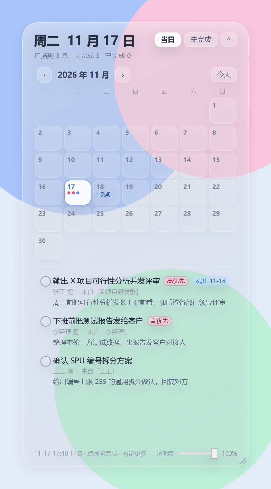
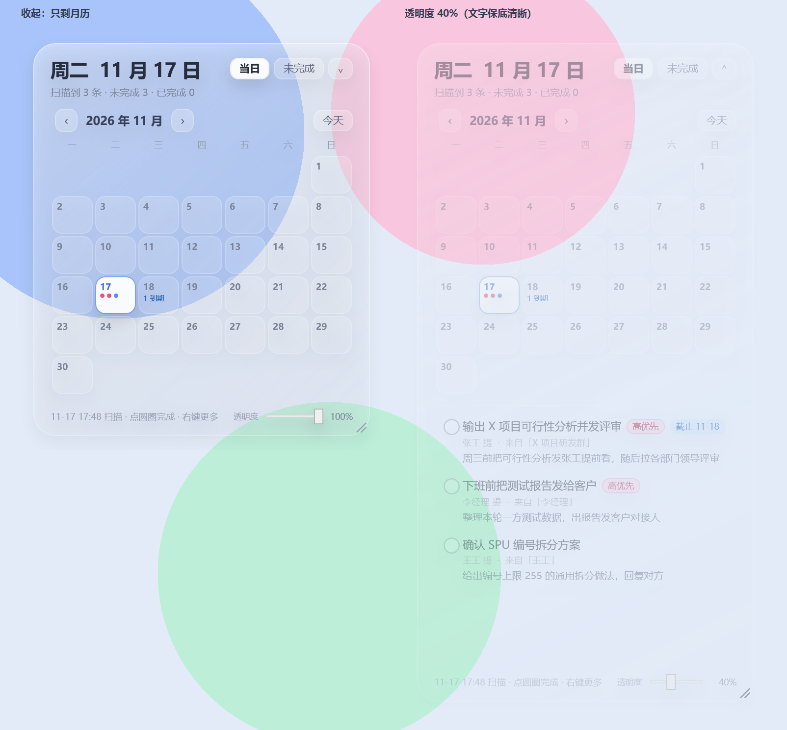

# feishu-task-widget

把飞书消息提炼成**任务提醒**，三种用法：命令行、Windows 桌面便签、DeepSeek Harness 插件（MCP）。

> Turn Feishu (Lark) messages into task reminders — CLI, a Windows desktop widget, and an MCP plugin for DeepSeek Harness.



> ⚠️ **先看这三件必须由人做的事**（AI 代劳不了）：① 在飞书开放平台建**自己的**自建应用并发布 → ② 用**本人账号**授权 → ③ **完全重启 DSH 宿主**（新开会话不算）。
> 完整清单见下面 [给 AI 的安装须知](#给-ai-的安装须知) 与 [docs/AI-INSTALL.md](docs/AI-INSTALL.md)。

## 它解决什么

飞书里「你确认下这个参数」「周五前给结论」这类话散落在私聊和群里，很容易漏。这个工具：

1. **扫**：私聊全取 + 群里只取 @我 或提到我名字的消息，各带前后 10 条上下文，产出给模型读的 `digest.md`；
2. **提炼**：由模型按判定规则产出结构化的 `tasks.json`（也可以你自己写）；
3. **落库 + 提醒**：合并进清单（同一条锚点消息只算一条任务），桌面上挂个便签，点一下就算完成。

三种用法共用一套数据（`tasks.json` / `open.md` / `daily-<日期>.md`），互不冲突。

## 特性

- **不碰服务端**：所有令牌、清单、日志都在本机数据目录，默认 `~/.feishu-task-widget`。
- **私聊问题有解**：飞书不提供私聊列表接口，本项目用消息搜索反推真人私聊会话（剔除机器人），再按会话全量读取。
- **幂等**：以消息 id（`anchorId`）去重，重复扫描不会重复建任务。
- **桌面便签**：WPF 无边框 + DWM Acrylic 真毛玻璃，可收起、可缩放、透明度 0–100%，点圆圈完成。
- **插件**：自带 MCP stdio 服务，DSH 里挂一行配置即可用 8 个工具。

## 判定规则（喂给模型的提示词）

只把下面这些算成任务：

- 明确要我做的事：「你确认下这个参数…」「帮忙补一份…」「周五前给结论」
- 有交付物或时限的：评审、报告、方案、报价、发版、会议结论里派给我的活
- 别人等我回复的问题：问我参数/进度/是否同意，且没有当场答复

**不算**：闲聊、@我看一下的通知、我自己已经答复过的、机器人/系统消息、别人认领的事。

产出格式（严格）：

```json
[{
  "title": "一句话，动词开头，≤30 字",
  "action": "具体要我做什么（可执行）",
  "requester": "谁提的（不确定就留空）",
  "owner": "我",
  "due": "YYYY-MM-DD（原文没给日期就留空，不要编）",
  "priority": "high|normal|low",
  "confidence": 0.0,
  "quote": "触发这条的原文片段（≤200 字，必须来自 digest）",
  "source": { "chat": "会话名", "chatId": "oc_…", "anchorId": "om_…", "anchorTime": 0 }
}]
```

拿不到锚点消息 id 就别输出那条——没有锚点就没有去重依据。

## 凭证：每个人用自己的

仓库里不含任何人的 App ID / App Secret，也不该含。使用前请在飞书自建**你自己的**应用，把凭证填进你自己的 «.env`。

这不只是洁癖，而是安全边界：本项目用**用户令牌**（user_access_token）按你的身份读**你能看到的**会话——
用别人的应用凭证，也读不到你的消息；反过来，你的凭证泄露则等于把你能看到的会话交出去。
所以 «.env` / «secrets.env` / 数据目录都被 «.gitignore` 挡住，提交前也别手动加进去。

## 给 AI 的安装须知

**如果你是代替人类安装的 AI：请先把这一节读完，并把「必须人做」的三项交给人类完成，不要自己猜或跳过。**

### 一、必须由人类完成（AI 停下来等）

| 事项 | 为什么 AI 做不了 | AI 该说什么 |
| --- | --- | --- |
| 建飞书自建应用、开权限、发布版本 | 需要企业管理员身份与审批 | 「请到 https://open.feishu.cn/app 建你自己的自建应用，开『网页应用』能力，重定向 URL 填 `http://localhost:3000/callback`，开这 8 个权限：…，发布后把 App ID/Secret 给我」 |
| 用本人飞书账号授权 | 授权必须由本人点浏览器 | 「我现在打开授权页，请用**你自己的**飞书账号点同意」 |
| 完全重启 DSH 宿主 | 只能由人关掉再启动 | 「插件配置改完必须完全重启 DSH（关掉窗口再 `dsh web`），新开会话不会生效」 |

### 二、容易装错的坑（照右列做，别照错误直觉做）

| 错误现象 | 真实原因 | 正确做法 |
| --- | --- | --- |
| 装完没工具，日志只有 `patch: entry "mcp-feishu-task" not found` | `cordis.patch.yml` 里写成了 `- id:` 覆盖式，被静默跳过 | 必须写成 `- insert:` + 列表，见 [docs/DSH-PLUGIN.md](docs/DSH-PLUGIN.md) |
| 改了配置、新开会话，还是没有工具 | patch 只在**宿主启动**时组合 | 完全重启宿主 |
| MCP 起不来，`Cannot find package '@modelcontextprotocol/sdk'` | 没跑 `npm install` | 先 `npm install`；`failOnStartupError` 先设 `true` 便于看错 |
| 启动报找不到 node | `command` 写的是相对名或别人的路径 | 先 `where.exe node`（Linux/macOS `which node`），把**绝对路径**填进 `command` |
| 语法错 / `await` 报错 | Node 版本太低 | 先 `node -v`，需要 **≥ 18** |
| `login` 打不开浏览器 | 无桌面/远程环境 | 用 `node src/index.mjs login --no-open`，手动复制打印出来的链接 |
| 端口被占 | 3000（login）或 3123（web） | `login --port 3001` / `web --port 3124` |
| 私聊列表是空的 | 没批 `search:message`，或没跑过 p2p 发现 | 先 `node src/index.mjs p2p --days 60`；企业不给搜索权限时群聊扫描仍可用 |
| 桌面便签起不来 | 不是 Windows，或缺 node 不在 PATH | 桌面便签只支持 Windows；先 `node -v` 确认 CLI 能用 |

### 三、装完必须跑的验收（按顺序，失败就停在这一步看原始报错）

```powershell
node -v                                  # ≥ 18
npm install
node src/scan.mjs --self-test            # ✅ 11 项全过（离线，不需要凭证）
node src/index.mjs status                # 凭证已配置 + 登录有效
node src/scan.mjs --hours 24 --json      # 返回 outDir，errors: []
where.exe node                           # 拿绝对路径填进 DSH 配置
dsh --profile web --dump-config | Select-String feishu   # 有条目、无 warning
# 重启宿主后，新会话里调用 feishu_status → 返回数据目录 + 令牌剩余分钟
```

### 四、可以直接复制给 AI 的完整提示词

见 [docs/AI-INSTALL.md](docs/AI-INSTALL.md)（含 8 步顺序与每步要停下来问人的位置）。

> 原始错误码与处理对照表：`99991679` 缺 scope、`99991695` 旧版授权、`20029` 缺网页应用能力 → [docs/INSTALL.md](docs/INSTALL.md)。
## 快速开始

```bash
git clone <这个仓库> feishu-task-widget && cd feishu-task-widget
npm install
cp .env.example .env            # 填 FEISHU_APP_ID / FEISHU_APP_SECRET
node src/index.mjs login        # 浏览器里用你自己的飞书账号授权
node src/index.mjs status

node src/index.mjs p2p --days 60 --max-resolve 80   # 发现私聊（建议先跑一次）
node src/index.mjs scan --hours 24                  # 产出 digest.md
# 让模型读 digest 产出 tasks.json，然后：
node src/index.mjs apply --file tasks.json
node src/index.mjs tasks
```

飞书应用怎么建、要开哪些权限、报 99991679 / 99991695 / 20029 怎么办：见 [docs/INSTALL.md](docs/INSTALL.md)。

想让 AI 代装：把 [docs/AI-INSTALL.md](docs/AI-INSTALL.md) 里那段提示词丢给它即可（含验收清单）。

## 三种用法

### 1. 命令行

```bash
node src/index.mjs help
node src/index.mjs status | login | scan | apply | tasks | done <id> | open <id> | p2p | names | web
```

### 2. Windows 桌面便签

双击 `desktop/start-widget.vbs`。可收起、可缩放、透明度 0–100%（拉到 0 是真透明，磨砂层会一起关掉）、右键菜单含置顶/磨砂/开机自启。
详见 [docs/DESKTOP.md](docs/DESKTOP.md)。



### 3. DeepSeek Harness 插件

在 `~/.dsh/profiles/web/cordis.patch.yml` 里挂 `mcp/server.mjs`，即可用 `feishu_scan` / `feishu_tasks` / `feishu_task_done` 等 8 个工具。
详见 [docs/DSH-PLUGIN.md](docs/DSH-PLUGIN.md)。

```yaml
- insert:
    - id: mcp-feishu-task
      name: '@deepseek-ai/dsh-mcp-client'
      config:
        serverName: feishu-task
        transport: stdio
        command: 'C:\Program Files\nodejs\node.exe'
        args:
          - 'C:\path\to\feishu-task-widget\mcp\server.mjs'
        toolCallTimeoutMs: 180000
        failOnStartupError: true
```

### 4. 作为 DSH skill（可选但推荐）

仓库带了一份 skill：`skills/feishu-task-widget/SKILL.md`。装进 DSH 的 skill 目录后，模型在动手前就会读到「三件必须人做的事」和常见坑，不用靠人再提醒一遍。

```powershell
# 项目级（只对这个工作区生效）
mkdir -Force .dsh\skills\feishu-task-widget | Out-Null
copy skills\feishu-task-widget\SKILL.md .dsh\skills\feishu-task-widget\

# 或用户级（所有会话生效）
mkdir -Force $env:USERPROFILE\.dsh\skills\feishu-task-widget | Out-Null
copy skills\feishu-task-widget\SKILL.md $env:USERPROFILE\.dsh\skills\feishu-task-widget\
```

装完新开会话即可（DSH 会扫描 `.dsh/skills` 与 `~/.dsh/skills`）。
## 目录结构

```
src/
  index.mjs            CLI 入口（转发到下面这些脚本）
  login.mjs            authen/v2 用户授权（拿 user_access_token）
  scan.mjs             扫描 → digest.md / digest.json
  apply.mjs            合并任务进清单（按 anchorId 去重）
  set.mjs              清单读写（state / done / open）
  p2p-discover.mjs     反推真人私聊会话
  web.mjs + desktop/web.html   浏览器版便签
  lib/
    config.mjs         路径与 .env 解析（数据目录、候选 .env）
    auth.mjs           凭证、令牌刷新
    api.mjs            OpenAPI 调用 + 限流重试
    im.mjs             消息拉取、富文本拍平、锚点挑选
    reminders.mjs      清单统一读写层（三个前端共用）
mcp/server.mjs         MCP stdio 服务
desktop/               Windows 便签（PowerShell + WPF）与启动器
docs/                  安装、插件、桌面说明
examples/              任务样例
```

## 数据与隐私

- 只写本机：令牌 `state/user-token.json`、扫描结果 `out/`、提醒清单 `reminders/`、便签偏好 `state/widget-pos.json`。
- 不上传任何东西，没有服务端；飞书 API 之外没有第三方请求。
- 仓库本身不含任何凭证、真实人名或公司数据，`.gitignore` 已挡住运行时产物。

## 常见问题

- **群里没 @我、也没提我名字的消息收不到**：这是设计（避免噪音）。
- **私聊列表为空**：先跑 `p2p --days 60`；搜索只能发现近期出现过关键词的私聊，冷门联系人可加大 `--days`。
- **令牌 2 小时就失效**：授权时要带 `offline_access`，否则拿不到 refresh_token。
- **桌面窗口看不见**：跑 `desktop/diagnose-widget.cmd` 看报错，或看数据目录的 `state/widget.log`。

## 许可证

MIT，见 [LICENSE](LICENSE)。

## CI

离线自检可以跑在 GitHub Actions 上：把 `docs/ci-selftest.yml` 复制成 `.github/workflows/selftest.yml` 即可（三个 Node 版本跑 `node src/scan.mjs --self-test`，不联网、不需要凭证）。

> 用 `gh` 推送时注意：默认 OAuth token 没有 `workflow` 权限，推 `.github/workflows/` 会被拒（`refusing to allow an OAuth App to create or update workflow`）。先 `gh auth refresh -s workflow` 再推，或者直接在网页上添加该文件。
